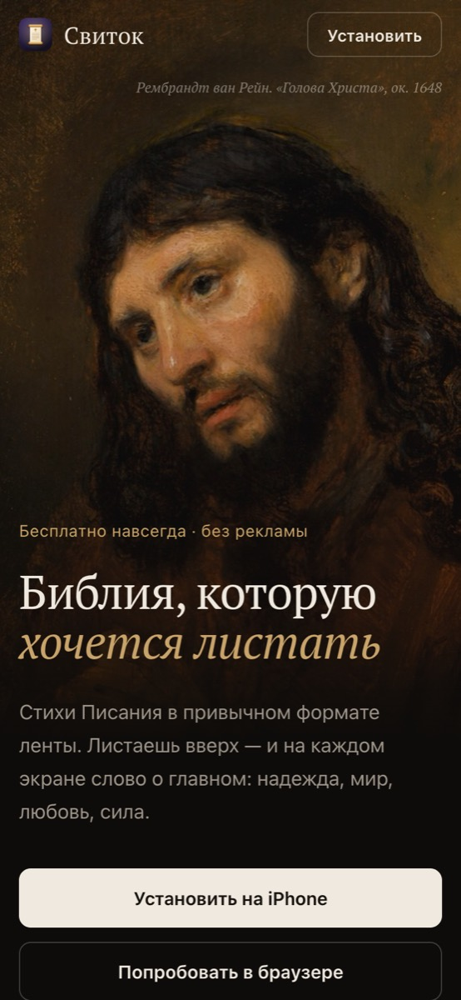
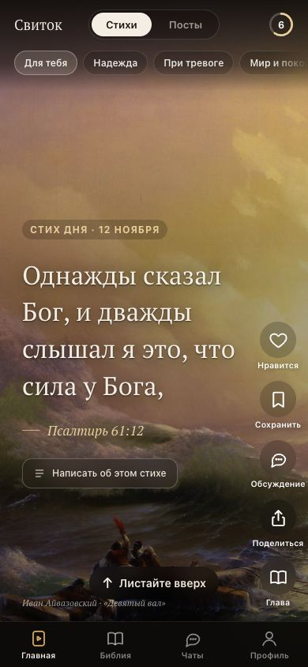
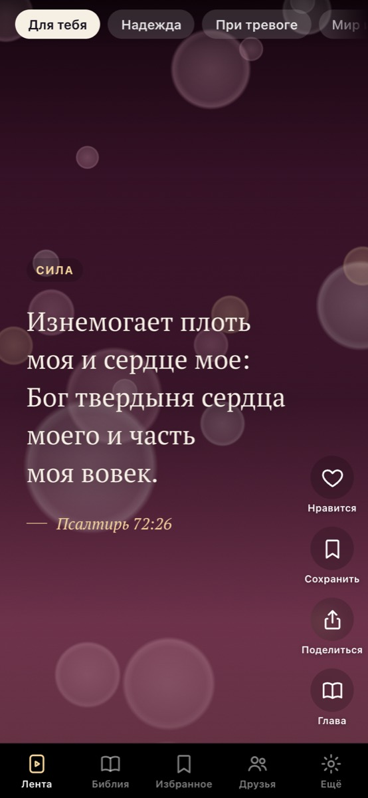
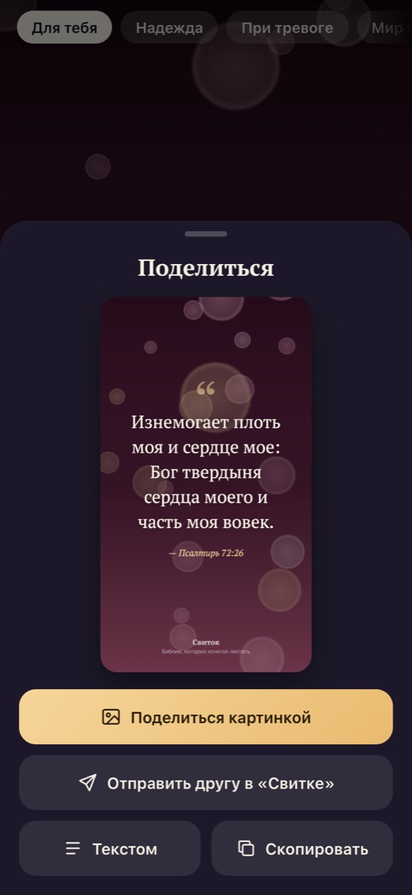
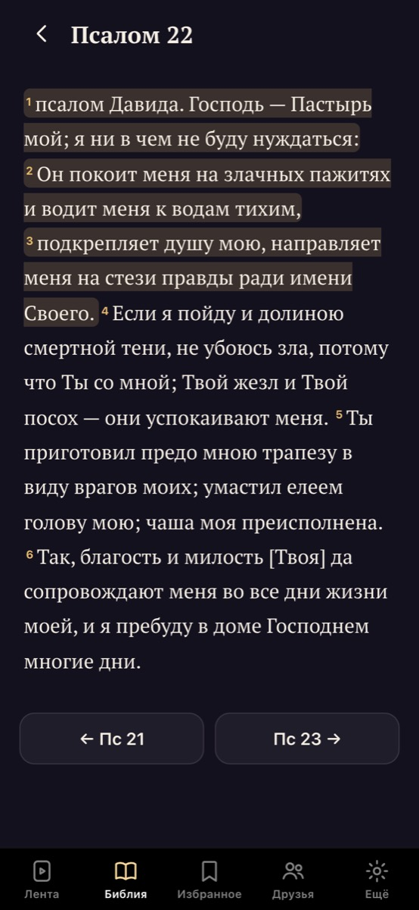
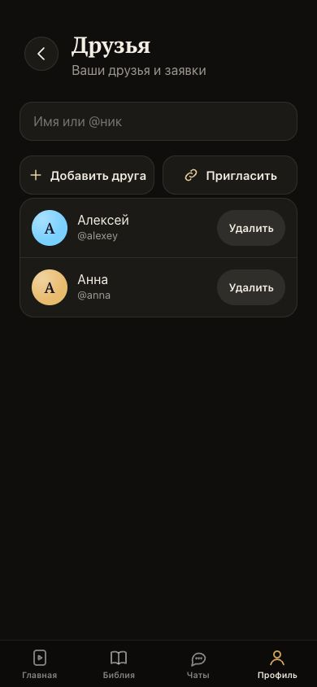
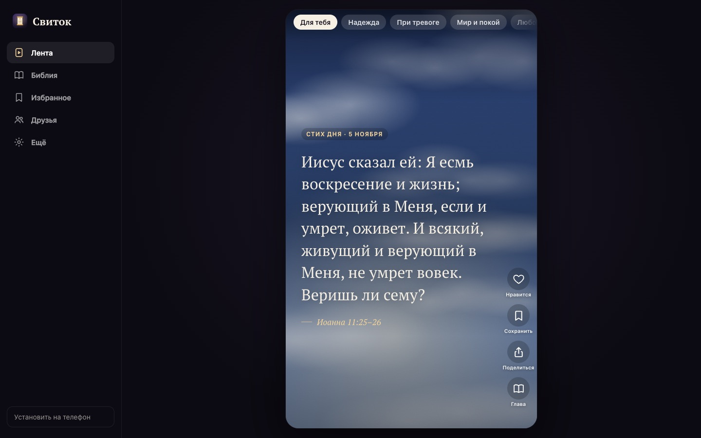
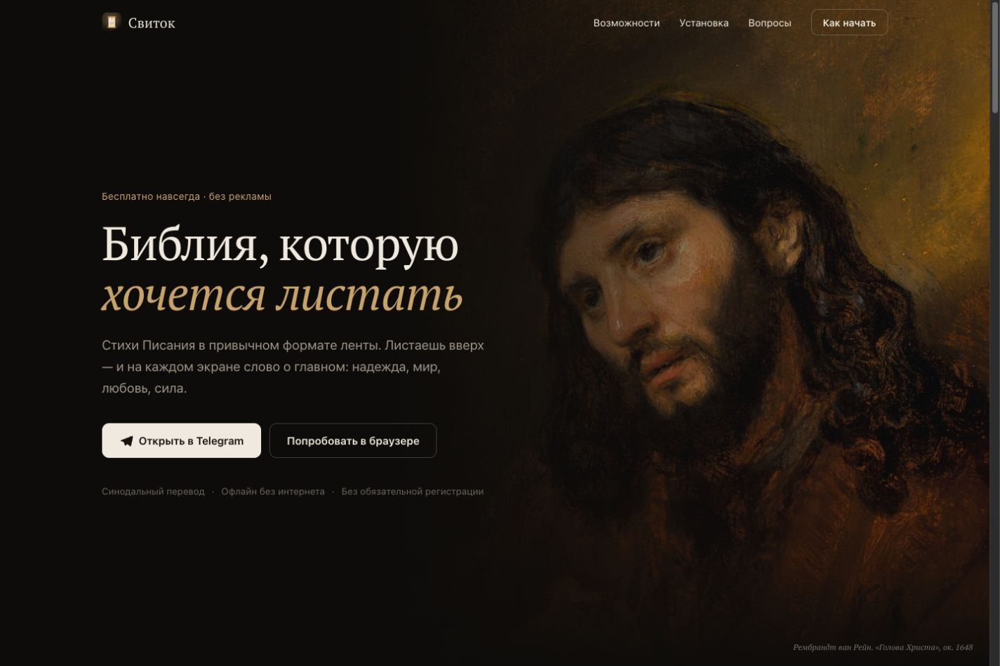

# Свиток — Библия, которую хочется листать

Бесплатное веб-приложение со стихами Библии (Синодальный перевод) в формате вертикальной ленты.
Без рекламы, без подписок, работает без интернета. Ставится на iPhone прямо из Safari — без App Store.

**Сайт:** https://mrdisa.github.io/svitok/

<p align="center">
  
  
  
  
</p>
<p align="center">
  
  
</p>

## Возможности

- **Лента стихов** — 178 подобранных стихов по 12 темам: надежда, при тревоге, мир и покой, любовь, сила, утешение, вера, благодарность, мудрость, прощение, молитва, слова Христа. Первым в ленте — «Стих дня».
- **«Для тебя»** — лента подстраивается под лайки, сохранения и время на стихе. Всё считается на телефоне.
- **Картины великих мастеров** — фон каждого стиха: 50 полотен (Рембрандт, Леонардо, Рафаэль, Караваджо, Айвазовский, Левитан, Поленов, Крамской, Нестеров, Рублёв, Фридрих, Ван Гог и другие) из Wikimedia Commons, все в общественном достоянии. Картина подбирается к теме стиха, на открытом стихе медленно приближается, внизу — подпись автора.
- **Слово дня** — при первом открытии за день: стих дня на фоне картины, «Сохранить», «Поделиться», «Глава».
- **Планы чтения** — Евангелие от Иоанна (21 день), Притчи (31), Псалтирь (30), Четыре Евангелия (40), Новый Завет (90), Библия за год (365). Свободный темп: «сегодня» — первый непрочитанный день; чтение по дням с кнопкой «Дальше» и отметкой дня.
- **Первый запуск** — короткое знакомство: как пользоваться, цель на день (2–15+ минут), любимые темы.
- **Цель на день** — кружок прогресса в ленте, серия дней подряд, поздравление при выполнении.
- **Вся Библия** — 66 канонических книг, переход из любого стиха к главе, выделение стихов, «Продолжить чтение».
- **Поделиться** — карточка 1080×1920 со стихом на фоне картины для сторис, текстом или копированием.
- **Избранное** — сохранённые и понравившиеся стихи.
- **Друзья** — вход через Telegram-бота, профиль с аватаркой, друзья по нику или ссылке-приглашению, отправка стихов друзьям с запиской. Без входа всё остальное работает как обычно.
- **Офлайн и автообновление** — Service Worker хранит приложение и всю Библию на телефоне и сам подхватывает новые версии при возвращении в приложение.

## Компьютерная версия

Кнопка «Попробовать в браузере» открывает полноценную версию для компьютера: боковое меню, лента карточкой по центру, листание колёсиком или стрелками ↓/↑, клавиша **L** — «нравится».

<p align="center">
  
</p>
<p align="center">
  
</p>

## Установка на iPhone

1. Открыть https://mrdisa.github.io/svitok/ в **Safari**.
2. «Поделиться» (в iOS 26 — сначала «⋯» внизу справа).
3. «На экран „Домой“» → «Добавить».

На Android: Chrome → меню ⋮ → «Установить приложение».

## Как устроено

Статический сайт без сборки (HTML + CSS + JS), хостинг — GitHub Pages. Сервер нужен только для друзей.

| Файл / папка | Что внутри |
|---|---|
| `index.html` | лендинг и разметка приложения (режим выбирается сам: с экрана «Домой» сразу открывается приложение) |
| `styles.css` | стили лендинга, приложения и компьютерной версии |
| `app.js` | лента, рекомендации, Библия, избранное, «Поделиться», настройки, лендинг |
| `data/paintings.json`, `img/art/` | картины для ленты: название, автор, темы, ссылка на страницу в Wikimedia Commons |
| `plans.js` | планы чтения: деление глав по дням, прогресс, экран плана, панель в читалке |
| `onboarding.js` | знакомство, цель на день, «Слово дня» |
| `social.js` | вход, профиль, аватарки, друзья, отправка стихов (Supabase) |
| `config.js` | публичные настройки Supabase (anon-ключ безопасен: доступ ограничен RLS) |
| `sw.js` | офлайн-кэш и автообновление — **при каждом релизе увеличивать `VERSION`** |
| `data/` | текст Библии по книгам, список книг, подборка стихов ленты |
| `tools/` | `build_data.py` собирает `data/` из RusSynodal.json ([scrollmapper/bible_databases](https://github.com/scrollmapper/bible_databases)); стихи ленты — в `tools/feed.txt` |
| `supabase/migrations/` | схема базы: профили, дружба, отправленные стихи, аватарки, правила доступа (RLS) |
| `supabase/functions/telegram/` | Edge Function входа через бота @svitok_login_bot |
| `vendor/` | supabase-js 2.45.4 (локальная копия, чтобы не зависеть от CDN) |
| `fonts/`, `img/`, `icons/` | шрифт PT Serif, картина для главной, иконки приложения |

### Вход через Telegram

Приложение создаёт случайный код → открывает бота `t.me/svitok_login_bot?start=login_<код>` → человек жмёт «Старт» →
Telegram присылает сообщение в Edge Function → приложение опрашивает функцию и получает одноразовый токен Supabase.
Работает и в приложении с экрана «Домой», где всплывающие окна Telegram-виджета не работают на iOS.

Секреты функции (`TELEGRAM_BOT_TOKEN`, `TELEGRAM_WEBHOOK_SECRET`) хранятся только в Supabase → Edge Functions → Secrets.

## Локальный запуск

```bash
python3 -m http.server 8321
```

Открыть http://localhost:8321 (лендинг) или http://localhost:8321/#app (приложение).

## Источники и права

- Текст: **Синодальный перевод** Библии — общественное достояние.
- Картины: главная — **Рембрандт, «Голова Христа»** (ок. 1648); в ленте — 50 полотен из Wikimedia Commons (список со ссылками на источники — `data/paintings.json`). Все в общественном достоянии.
- Шрифт: **PT Serif** (ParaType), лицензия SIL Open Font License.
