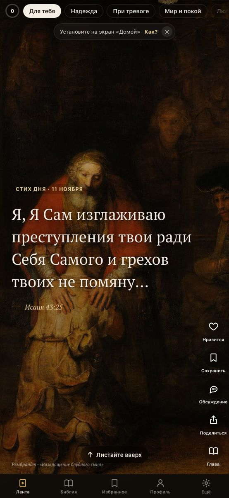
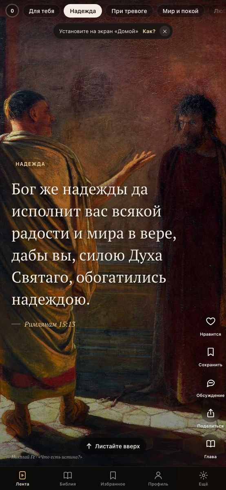
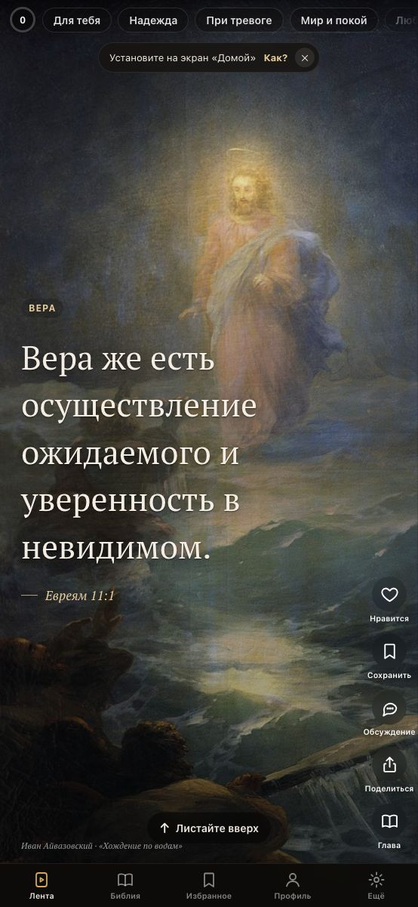
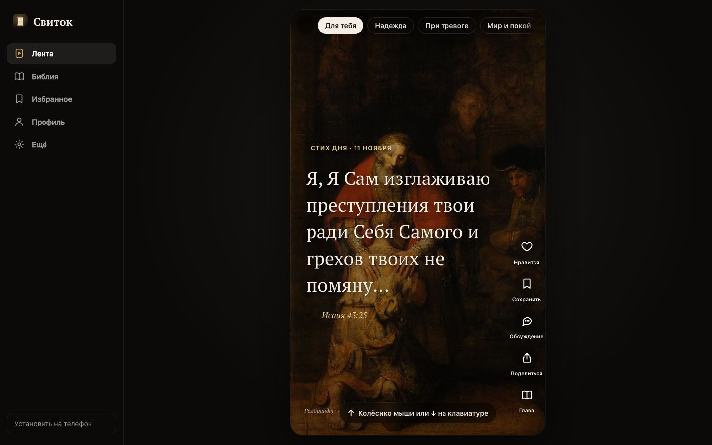
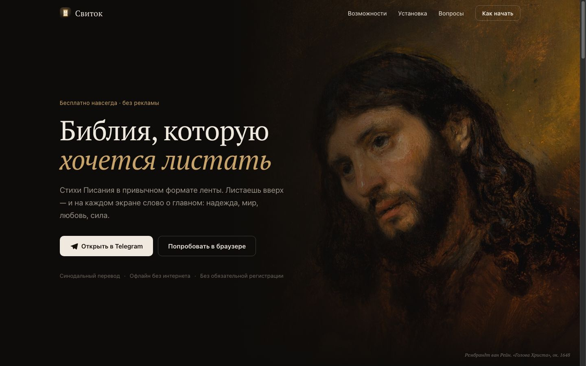

# Свиток — Библия, которую хочется листать

Бесплатное веб-приложение со стихами Библии (Синодальный перевод) в формате вертикальной ленты.
Без рекламы, без подписок, работает без интернета. Ставится на iPhone прямо из Safari — без App Store.

**Сайт:** https://mrdisa.github.io/svitok/

<p align="center">
  
  
  
</p>

<p align="center"><i>Стихи в ленте — каждый на фоне картины</i></p>

## Возможности

- **Лента стихов** — 178 подобранных стихов по 12 темам: надежда, при тревоге, мир и покой, любовь, сила, утешение, вера, благодарность, мудрость, прощение, молитва, слова Христа. Первым в ленте — «Стих дня».
- **«Для тебя»** — лента подстраивается под лайки, сохранения и время на стихе. Всё считается на телефоне.
- **Картины великих мастеров** — фон каждого стиха: 50 полотен (Рембрандт, Леонардо, Рафаэль, Караваджо, Айвазовский, Левитан, Поленов, Крамской, Нестеров, Рублёв, Фридрих, Ван Гог и другие) из Wikimedia Commons, все в общественном достоянии. Картина подбирается к теме стиха, на открытом стихе медленно приближается, внизу — подпись автора.
- **Поиск по Библии** — офлайн по всем 31 000 стихам: ссылки («Ин 3:16», «Псалом 22», «1 Кор 13») и слова с подсветкой, фильтр Ветхий/Новый Завет, точная фраза — первой.
- **Синхронизация** — для вошедших избранное, лайки, цель, серия, планы и место чтения сохраняются в аккаунте; при первом входе на устройстве данные объединяются.
- **Напоминание «Слово дня»** — пуш-уведомление (iPhone с экрана «Домой», Android, компьютер) и/или сообщение от Telegram-бота в выбранное время по часовому поясу человека.
- **Мини-апп в Telegram** — «Свиток» открывается прямо в Telegram кнопкой у бота; автоматический вход по подписанным данным Telegram, на весь экран, без конфликта со смахиванием.
- **Бот [@svitok_bible_bot](https://t.me/svitok_bible_bot)** — приветствие с картиной и кнопками; `/day` — «Слово дня» картиной, `/verse` — стих по теме, `/remind` — время напоминания прямо в чате, `/help`. Пришлите ссылку (`Ин 3:16`, `Псалом 22`) или слова — бот найдёт стих. В любом чате `@svitok_bible_bot не бойся` — поиск и отправка стиха другу; кнопка «Открыть в «Свитке»» ведёт прямо к главе.
- **Слово дня** — при первом открытии за день: стих дня на фоне картины, «Сохранить», «Поделиться», «Глава».
- **Планы чтения** — Евангелие от Иоанна (21 день), Притчи (31), Псалтирь (30), Четыре Евангелия (40), Новый Завет (90), Библия за год (365). Свободный темп: «сегодня» — первый непрочитанный день; чтение по дням с кнопкой «Дальше» и отметкой дня.
- **Первый запуск** — короткое знакомство: как пользоваться, цель на день (2–15+ минут), любимые темы.
- **Цель на день** — кружок прогресса в ленте, серия дней подряд, поздравление при выполнении.
- **Вся Библия** — 66 канонических книг, переход из любого стиха к главе, выделение стихов, «Продолжить чтение».
- **Поделиться** — карточка 1080×1920 со стихом на фоне картины для сторис, текстом или копированием.
- **Избранное** — сохранённые и понравившиеся стихи.
- **Друзья** — вход через Telegram-бота, профиль с аватаркой, друзья по нику или ссылке-приглашению, отправка стихов друзьям с запиской. Без входа всё остальное работает как обычно.
- **Обсуждения под стихами** — под любым стихом в ленте и в главе Библии можно поговорить о нём: читают все, в том числе без входа, пишут вошедшие. Ответы на комментарий — один уровень, к своему стиху можно ответить, а не своё — удалить или пожаловаться. Мат и слишком частая отправка отсекаются на сервере, три жалобы скрывают комментарий до разбора. О новых ответах сообщает значок в профиле (раздел «Уведомления» в «Ещё» можно выключить).
- **Офлайн и автообновление** — Service Worker хранит приложение и всю Библию на телефоне и сам подхватывает новые версии при возвращении в приложение.

## Компьютерная версия

Кнопка «Попробовать в браузере» открывает полноценную версию для компьютера: боковое меню, лента карточкой по центру, листание колёсиком или стрелками ↓/↑, клавиша **L** — «нравится».

<p align="center">
  
</p>
<p align="center">
  
</p>

## Как начать

**Основной способ — Telegram:** откройте [@svitok_bible_bot](https://t.me/svitok_bible_bot/app) и нажмите «Открыть».
«Свиток» запустится как мини-приложение, вход автоматический, а в «Ещё» можно добавить иконку на экран «Домой»
и включить «Слово дня» от бота.

**Без Telegram — как веб-приложение:**
- iPhone: открыть https://mrdisa.github.io/svitok/ в **Safari** → «Поделиться» (в iOS 26 — сначала «⋯») → «На экран „Домой“» → «Добавить».
- Android: Chrome → меню ⋮ → «Установить приложение».

## Как устроено

Статический сайт без сборки (HTML + CSS + JS), хостинг — GitHub Pages. Сервер нужен только для друзей и обсуждений.

| Файл / папка | Что внутри |
|---|---|
| `index.html` | лендинг и разметка приложения (режим выбирается сам: с экрана «Домой» сразу открывается приложение) |
| `styles.css` | стили лендинга, приложения и компьютерной версии |
| `app.js` | лента, рекомендации, Библия, избранное, «Поделиться», настройки, лендинг |
| `data/paintings.json`, `img/art/` | картины для ленты: название, автор, темы, ссылка на страницу в Wikimedia Commons |
| `tg.js` | режим мини-аппа Telegram: SDK, на весь экран, отступы, «Поделиться» через Telegram |
| `reminders.js` | экран «Напоминание»: время, пуш-подписка, «Слово дня» в Telegram |
| `search.js` | поиск: разбор ссылок, индекс текста, результаты с подсветкой |
| `plans.js` | планы чтения: деление глав по дням, прогресс, экран плана, панель в читалке |
| `onboarding.js` | знакомство, цель на день, «Слово дня» |
| `social.js` | вход, профиль, аватарки, друзья, отправка стихов, синхронизация прогресса (Supabase) |
| `comments.js` | обсуждения под стихами: отметки в ленте и в главе, шторка обсуждения, ответы, жалобы, «Ответы вам» в профиле |
| `config.js` | публичные настройки Supabase (anon-ключ безопасен: доступ ограничен RLS) |
| `sw.js` | офлайн-кэш и автообновление — **при каждом релизе увеличивать `VERSION`** |
| `data/` | текст Библии по книгам, список книг, подборка стихов ленты |
| `tools/` | `build_data.py` собирает `data/` из RusSynodal.json ([scrollmapper/bible_databases](https://github.com/scrollmapper/bible_databases)); стихи ленты — в `tools/feed.txt` |
| `supabase/migrations/` | схема базы: профили, дружба, отправленные стихи, аватарки, обсуждения под стихами, правила доступа (RLS) |
| `supabase/functions/telegram/` | Edge Function бота: вход («Старт» и автовход в мини-аппе), а в `bot.ts` — приветствие, команды, кнопки, поиск стихов и inline-режим |
| `docs/bot/` | аватарка и картинка описания бота для BotFather (`tools/bot-avatar.html`, `tools/bot-cover.html`) |
| `supabase/functions/notify/` | Edge Function напоминаний: подписки и ежедневная рассылка |
| `vendor/` | supabase-js 2.45.4 (локальная копия, чтобы не зависеть от CDN) |
| `fonts/`, `img/`, `icons/` | шрифт PT Serif, картина для главной, иконки приложения |

### Вход через Telegram

Приложение создаёт случайный код → открывает бота `t.me/svitok_bible_bot?start=login_<код>` → человек жмёт «Старт» →
Telegram присылает сообщение в Edge Function → приложение опрашивает функцию и получает одноразовый токен Supabase.
Работает и в приложении с экрана «Домой», где всплывающие окна Telegram-виджета не работают на iOS.

Секреты функции (`TELEGRAM_BOT_TOKEN`, `TELEGRAM_WEBHOOK_SECRET`) хранятся только в Supabase → Edge Functions → Secrets.

## Обсуждения под стихами

Комментарии живут в базе, а не на телефоне: **читать** их может кто угодно, даже без входа (гостю имя автора
отдаёт представление `verse_comments` — сама таблица профилей закрыта), **писать** — только вошедшие.
Стих определяется ключом `книга.глава.стих` с книгой от единицы, поэтому в ленте и в главе обсуждение одного
и того же стиха — одно и то же.

Правила проверяет сервер, а не приложение: грубые слова, отправка чаще десяти комментариев в час, ответ на ответ
и слишком длинный текст отсекаются триггером `comment_before_insert`, так что обойти их правкой кода нельзя.
Свой комментарий можно удалить (но не переписать), на чужой — пожаловаться; три жалобы скрывают комментарий
до разбора. Об ответе на ваш комментарий в профиле появляется «Ответы вам» и значок на вкладке — это можно
выключить в «Ещё» → «Уведомления».

Чтобы включить обсуждения, выполните один раз в Supabase → SQL Editor файл
`supabase/migrations/20261111120000_comments.sql` (после `20261105120000_social.sql`).

## Напоминания

Функция `notify` раз в 15 минут вызывается расписанием Supabase (pg_cron + pg_net) с секретным заголовком `x-cron-secret`
и отправляет «Слово дня» тем, у кого по их часовому поясу наступил выбранный час. Само расписание создаётся SQL-запросом вне репозитория,
потому что содержит секрет; секреты функции: `VAPID_PUBLIC_KEY`, `VAPID_PRIVATE_KEY`, `CRON_SECRET`, `TELEGRAM_BOT_TOKEN`.

## Локальный запуск

```bash
python3 -m http.server 8321
```

Открыть http://localhost:8321 (лендинг) или http://localhost:8321/#app (приложение).

## Источники и права

- Текст: **Синодальный перевод** Библии — общественное достояние.
- Картины: главная — **Рембрандт, «Голова Христа»** (ок. 1648); в ленте — 50 полотен из Wikimedia Commons (список со ссылками на источники — `data/paintings.json`). Все в общественном достоянии.
- Шрифт: **PT Serif** (ParaType), лицензия SIL Open Font License.
